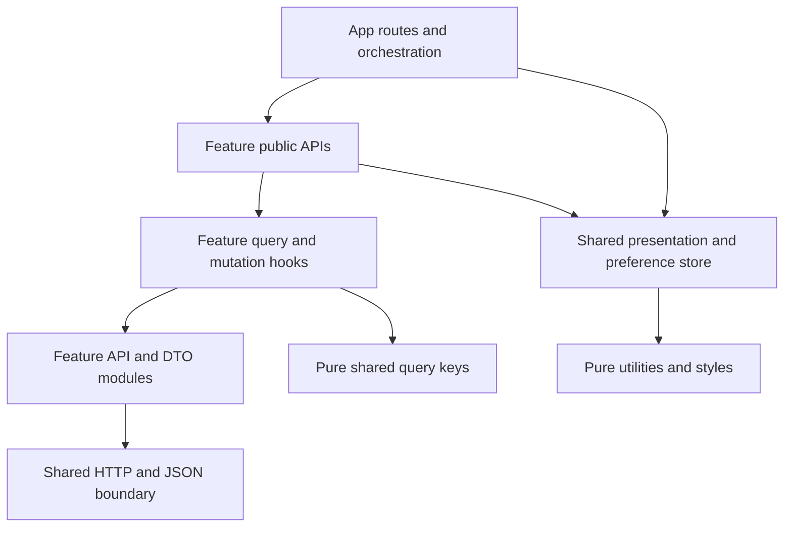

# ENCORE — frontend architecture blueprint

Status: implemented frontend architecture, 2026-10-27. Project name: Event Ticketing Frontend; website name: Encore. See IMPLEMENTATION_STATUS.md and VERIFICATION.md for implementation evidence and live/mocked limits. Keep this bundle and `.agents/skills/` at the frontend root. Existing backend and reference sources remain unchanged.

Read [API_CONTRACT.md](API_CONTRACT.md) for verified capabilities, [DESIGN_SYSTEM.md](DESIGN_SYSTEM.md) for product presentation, and [IMPLEMENTATION_PLAN.md](IMPLEMENTATION_PLAN.md) for delivery order. Backend root: `/Users/asus/EventTicketingApi`; reference root: `/Users/asus/Desktop/the-wild-oasis`.

## Decision summary

Build a React + strict TypeScript + Vite single-page application. Organize domain operations by feature, use app-level route composition when multiple features meet, and share only technical infrastructure and domain-neutral UI. TanStack Query owns server state. URL parameters own shareable search/page state. Forms and ticket selections remain local. Zustand holds one justified shared preference: display event times in viewer-local time or UTC.

Public discovery, authentication, personal booking and cancellation are the first release slice. Add admin management and a limited organizer workspace afterward. Ticket categories and authentication are necessary features even though the original brief named only countries, venues, events and bookings. Current API support is broader than that brief; management read-model gaps are explicit rather than patched with inferred data.

Use current compatible stable packages at implementation time and commit their lockfile. Do not copy the reference's version pins. Verified documentation currently describes TanStack Query v5, React Hook Form v7, and Tailwind v4 APIs. React Router Declarative Mode fits this SPA because Query supplies its data lifecycle; no competing loader cache or framework migration is needed. See [React Router modes](https://reactrouter.com/start/modes).

## What the reference teaches us

Inspected working tree HEAD: `10a150c9989846dcd479f2a7dfa92f1409279bd1`; no changes reported at inspection. Static source analysis only: no install/build or Supabase access. It is React/JavaScript, not TypeScript; no `.ts`/`.tsx` application types or test suite were found. Installed declarations for React do not make it a TypeScript project.

| Source evidence (relative to reference root) | Valuable principle | Adaptation / avoid reproducing |
| --- | --- | --- |
| `src/pages/Cabins.jsx`, `Settings.jsx` | Pages compose feature components with little logic | Keep thin pages; move multi-feature orchestration to app routes |
| `src/features/cabins/useCabins.js`, `useDeleteCabin.js`, settings hooks | Reusable resource hooks hide fetching/mutations and invalidate cache | Typed query options, cancellation and scoped invalidation; preserve error/status information |
| `src/services/apiCabins.js`, `apiSettings.js`, `apiBookings.js` | Network access separated from rendering | Move endpoint modules inside owning features; replace direct Supabase access with documented REST |
| `src/features/cabins/CreateCabinForm.jsx` | One create/edit form can share real fields and rules; React Hook Form manages input | Use explicit create/update DTO builders and numeric conversion; avoid an optional-id “do everything” service |
| `src/ui/{Button,Input,FormRow,Empty,Spinner}.jsx` | Shared visual primitives and consistent states | Tailwind semantic tokens and accessible field wiring; no generic schema-driven form framework |
| `src/ui/{Modal,Menus,Table}.jsx` | Composition avoids duplicating interaction layout | Do not copy custom cloneElement/context machinery by default; use accessible dialog primitive and semantic tables |
| `src/hooks/useOutsideClick.js` | A narrow hook has a clear lifecycle and cleans up listeners | Add shared hooks only when multiple callers need the same behavior; don't reimplement a dialog library's behavior |
| `src/hooks/useLocalStorageState.js` | Persistence can be isolated | Storage parse/write failures are unhandled; only non-sensitive validated preference data should persist |
| `src/utils/helpers.js` | Formatting has a common home | Separate time and money modules; no growing helpers catch-all; date rules must fit API UTC semantics |
| `src/App.jsx`, `src/ui/AppLayout.jsx` | One QueryClient, shared providers, nested layout/Outlet | Separate composition files; app layout supplies navigation to pure shared shell; mobile layout is not a fixed 26rem sidebar |
| `src/styles/GlobalStyles.js`, `src/styles/index.css` | CSS variables communicate a visual language | Their token/reset content is duplicated; use one token source and one global stylesheet |

Specific source problems to learn from:

- `CabinTable` passes `coloumns`, but Table reads `columns`; `Menus.Toggle` reads `opendId`, while context provides `openId`. Typed props/context would catch these errors.
- `Menus.Button` ignores its passed icon/onClick. `Modal` lacks explicit dialog semantics, focus trap/restore and Escape handling. Icon-only controls lack names in several places. Compound syntax alone does not ensure correct behavior or accessibility.
- `CabinTable` obtains `error` but does not render it before passing potentially absent cabins to Table.Body. Empty, failed and pending queries need separate states.
- `createEditCabin` combines insert/update/image storage and rollback. Its failure cleanup accesses `data[0].id` after `.single()`; this branch is inconsistent with the returned shape. ENCORE has no upload API, so none of this workflow transfers.
- Bookings, Dashboard and Login pages are placeholders; booking components contain fake/empty data. Authentication components import missing `useUser`, `useUpdateUser`, or FormRowVertical; BookingTableOperations references missing SortBy. These are static observations, not a claim that every unused file is loaded by the current app.
- Settings updates submit partial fields on blur. ENCORE PUT operations require full write bodies and explicit submission; copying that interaction could lose data or fail validation.
- Reference routing does not enforce authentication. Its hotel booking/payment/checkout fields cannot be reused as event API contracts. Existing fixture uploader performs database mutations and must never become a product feature.
- Services are centralized while features own hooks, so a feature spans several directories. Some UI modules import each other in presentation-specific ways, and check-in imports booking UI. There is no enforced dependency boundary. ENCORE makes the permitted composition point explicit.

Keep feature locality, thin pages, resource hooks, form reuse and shared primitives. Avoid a component context for every group of elements, generic repositories, one global services bag, copied placeholder dashboards, Redux-style server mirrors, a domain class hierarchy, and factories that generate every CRUD screen.

## Folder plan: grow by milestone

This tree is the target shape, not a request to create all files immediately. A small feature uses flat `api.ts`, `types.ts`, `queries.ts`, `mutations.ts` files. Split a file into an api/ or hooks/ folder only when it contains several distinct responsibilities that are hard to navigate. Do not create empty folders.

```text
frontend/
  ARCHITECTURE.md  API_CONTRACT.md  DESIGN_SYSTEM.md  IMPLEMENTATION_PLAN.md
  AGENTS.md
  .agents/skills/{frontend-architecture,api-integration,frontend-quality-review}/SKILL.md
  src/
    app/
      App.tsx
      providers.tsx               # one QueryClient; transport/session wiring
      config.ts                  # validate public environment
      router.tsx                 # declarative route map and role gates
      pages/                     # composition across feature public APIs
        EventDiscoveryPage.tsx
        EventDetailsPage.tsx
        BookingDetailsPage.tsx
        VenueDetailsPage.tsx
        EventWorkspacePage.tsx
      layout/                    # connects auth/navigation to shared shells
      session.ts                 # login/logout/refresh orchestration
    features/
      events/
        api.ts  types.ts  queries.ts  mutations.ts  public.ts
        filters.ts               # URL normalization for EventQuery
        validation.ts            # event form rules and DTO mapping
        components/{EventCard,EventHeader,EventForm}.tsx
        pages/EventCreatePage.tsx # only if feature-only; otherwise app/pages
      countries/
        api.ts  types.ts  queries.ts  mutations.ts  public.ts
        components/              # country selector and form as needed
      venues/
        api.ts  types.ts  queries.ts  mutations.ts  public.ts
        components/              # venue summary/selector/create form
      ticket-categories/
        api.ts  types.ts  queries.ts  mutations.ts  public.ts
        validation.ts
        components/              # management fields/category listing
      bookings/
        api.ts  types.ts  queries.ts  mutations.ts  public.ts
        validation.ts            # 20-ticket input, cumulative targets
        components/{BookingForm,BookingSummary,CancelBookingForm}.tsx
        pages/MyBookingsPage.tsx  # history itself; app composes event enrichment
      auth/
        api.ts  types.ts  queries.ts  public.ts
        components/{SignInForm,RegisterForm,SessionGate}.tsx
      accounts/                  # add only at admin-account milestone
        api.ts  types.ts  mutations.ts  public.ts
        pages/CreateAccountPage.tsx
    components/
      ui/                        # Button, Field, Dialog, Alert, Pagination
      layout/                    # pure shell/container props, no feature imports
    lib/
      api/{client,errors,query-params,json-codec,types}.ts
      query/{client,keys}.ts
      auth/session-vault.ts      # memory credentials, not profile cache
    stores/display-preferences.ts
    utils/{date-time,money}.ts
    styles/{tokens,globals}.css
    assets/                      # only actual local art/font assets
    main.tsx
  tests/                         # integration fixtures and setup
  e2e/                           # main browser journeys
```

Responsibilities:

- `app`: composition root, routing, environment, session coordination, cross-feature workflows. Domain operations still belong to features. This small folder is not a second business layer.
- `features`: DTOs, endpoints, Query hooks, resource-specific validation, UI and isolated pages. Ticket availability belongs to ticket-categories even though its route begins with events. Event-wide booking history belongs to bookings. Ownership follows responsibility, not URL prefixes.
- `components/ui`: domain-neutral accessible primitives; `components/layout`: presentational layout. Neither fetches business data. `app/layout` provides auth-dependent navigation and account controls.
- `lib/api`: transport and JSON boundary; `lib/query`: QueryClient defaults plus pure shared key factories; `lib/auth`: session credentials and coordination primitives without React dependencies.
- `stores`: genuinely shared client preference only. `utils`: pure time/money transformations, with no network or React. `styles`: semantic tokens and global rules. Assets contain only available assets, not promised media.
- Keep tests beside the implementation for small pure units/components; shared test fixtures belong in tests, user journeys in e2e. No blanket global hooks/ or types/ directory: Page and ApiError belong in lib/api/types, feature types stay with their feature.

## Responsibility and dependency rules

| Module | Owns | Must not own |
| --- | --- | --- |
| Page | URL parsing, composition, route states, navigation and success destination | Fetch implementation, raw DTO serialization, inventory arithmetic |
| Component | Accessible presentation and local interaction; connected feature form may call its own hooks | Generic shared component importing features, direct fetch, global cache rules |
| Custom hook | A reusable React lifecycle or interaction with an actual consumer | Pure formatting masquerading as a hook, unrelated operations in a giant facade |
| API module | Explicit endpoint, method, DTO encoder/decoder and request | QueryClient, React, navigation, toasts, user-facing modal state |
| Query hook/options | Key, query function with signal, enabled conditions, staleness | Copying response into Zustand or useEffect state |
| Mutation hook | One operation, retry policy, authoritative cache updates and invalidation | Page-specific navigation, form reset, duplicate global/inline error reporting |
| Zustand | Time-display preference and its persistence | Events, bookings, profile, roles, auth responses, loading/error mirrors, form state |
| Pure utility | Deterministic conversion/formatting | Side effects, storage, request dispatch or hidden business authorization |

Allowed flow:



Runtime imports between sibling features are disallowed. App pages import named exports from `features/*/public.ts`; internal files import local files directly, not their own barrel. No root `features/index.ts`. Features and shared code never import app. Shared technical code never imports feature DTOs; key factories accept normalized parameter objects supplied by callers.

Two explicit type-only dependencies are reasonable: countries' nested read DTO can use venues' exported VenueSummaryDto; BookingForm props can use ticket-categories' exported AvailabilityDto. No reverse type dependency is permitted. This reuses actual shared shapes without turning them into runtime coupling. Other cross-feature needs go through app composition or a small explicit view prop. Use restricted-import lint rules when the application is initialized, including rules against deep sibling imports and shared-to-feature imports.

One pure `lib/query/keys.ts` registry lets each mutation invalidate affected foreign caches without importing another feature's hooks. It contains key factories only, never network/business logic. This is intentionally simpler than a global event bus or injecting a cache-effects service into every feature.

### Concrete event-details flow

1. `app/pages/EventDetailsPage.tsx` validates the route ID as a positive 32-bit integer. Invalid IDs show a route error before requests.
2. Call events' `useEvent(id)` and ticket-categories' `useEventAvailability(id)` independently. Once event data supplies venueId, call venues' `useVenue(venueId)`; country lookup is optional if the UI displays the country. Each reads a distinct Query cache key.
3. Render EventHeader with name, normalized times and description. Venue failure is a section retry, not a reason to hide the event. Availability failure blocks booking controls while retaining event content.
4. Pass eventId, event start and decoded availability to bookings' BookingForm. Quantities stay in that form. It constructs only eventId and positive category/quantity items, validates distinct IDs/total <=20 and estimates with exact USD cents. It never sends prices/customerId.
5. App supplies a sign-in interaction when unauthenticated. Use an accessible sign-in dialog on this route so the selection remains mounted; standalone `/sign-in` also works. Do not place passwords or ticket drafts in URL parameters. Auth callbacks belong to app/session. Refresh near-expiry credentials before submission, then submit once.
6. `useCreateBooking` sends the operation with retries disabled. On 201 it seeds the caller-scoped booking detail, invalidates own history, event booking history and availability. The page navigates to `/bookings/{id}` using the returned DTO ID. Server success remains success if a subsequent refetch fails.
7. On stock conflict, refetch availability and let the user revise quantities. On unknown outcome, retain the form in a reconciliation state and link to `/bookings?eventId={id}`; never automatically submit again. On 401, show sign-in and require a deliberate resubmission after checking outcome where needed.

## Routing and pages

These are **frontend URLs**, not new API routes. `/` redirects to `/events`.

| Route | Composition and access |
| --- | --- |
| `/events` | Public discovery; search, country/venue, exact city and date bounds, paging |
| `/events/:eventId` | Public detail + venue + availability + local booking form |
| `/venues`, `/venues/:venueId` | Public paged directory / details + events filtered by venueId |
| `/countries`, `/countries/:countryId` | Public paged directory / details + paged venues filtered by countryId |
| `/sign-in`, `/register` | Public auth; registration success directs to sign-in |
| `/bookings`, `/bookings/:bookingId` | Authenticated own history / detail and cancellation |
| `/account` | Authenticated profile from `/me`, read-only names; logout |
| `/manage/events/new` | Admin/EventOrganizer create form |
| `/manage/events/:eventId` | Explicit event workspace: edit/category management/history; Admin or server-confirmed owner |
| `/manage/events` | Admin public-event list with management links. Organizer sees an event-ID entry / create entry, not a fictitious owned list |
| `/manage/countries`, `/manage/venues` | Admin country CRUD and venue read/create/delete; venue edit deferred |
| `/manage/accounts/new` | Admin new organizer/admin account only |
| `*` | Not-found with safe path back to discovery |

Session/role gates wait for `/me`; never render forbidden controls while profile is loading. Backend remains authoritative. On explicit organizer workspaces, the existing read-only event-history GET can establish access; 403 renders an access-denied workspace, 404 renders missing. Successful public event GET does not establish ownership. No silent scan of every event's protected history to discover owners. Newly created event links remain useful without asserting a complete owned list.

Use route-level lazy imports for management code; keep discovery initially simple. Configure SPA fallback at deployment for deep links. Use React error boundaries for render failures plus explicit query states; no assumption that Declarative Mode provides data-router error elements. Allow only same-origin known relative return paths after sign-in (reject `//host`, absolute URLs and invalid routes).

## State ownership and Query conventions

| State | Owner | Lifetime |
| --- | --- | --- |
| Events, venues, countries, categories, availability, bookings, `/me` | TanStack Query | Cache policy per resource; private cache scoped to session |
| Search, filter, page number | URLSearchParams | Back/forward/reload/shareable |
| Search text before submission, quantities, field errors, dialog state | Component / React Hook Form | Current interaction |
| Time-display mode: local or UTC | One Zustand preference store | Validated localStorage; no user/account data |
| Opaque token pair + expiry | In-memory credential vault | Current browser-tab session; never Query response cache or Zustand persistence |

Tokens are a transport credential exception, not a second copy of profile/server resources. Auth API promises deliver tokens directly to app/session and the vault; auth form pending/error remains local. Do not retain token/password payloads in Query mutations/devtools or logs. `/me` remains exclusively in Query. Refresh coordination is one promise with a session generation counter; reject results from a session invalidated by logout or a later login. A refresh transport failure is retryable by explicit user action, not an excuse to loop; refresh 401 clears the session.

Credential-bearing forms (registration and admin account creation included) require the same care: never pass passwords as retained mutation variables. Where TanStack mutation status is used, invoke a form-scoped submission callback with no secret variables/result, return void, reset promptly and use zero mutation gcTime. The callback constructs the request from the current form only during submission and clears credentials afterward. The application session coordinator consumes login tokens before returning void. The local pending state on login/refresh is a deliberate credential-lifecycle exception; business mutations and their cache effects remain Query-owned.

Zustand's preference has a real consumer across event cards, details and booking summaries. Persist only `timeDisplay: "local" | "UTC"`, validate on load, version the small object, and fall back to local if storage is unavailable/corrupt. It does not control which events the API returns. See [Zustand persist](https://zustand.docs.pmnd.rs/reference/middlewares/persist.html). If the preference control is cut from scope, defer the store rather than inventing another use for Zustand.

### Keys, hooks and fetching

Factories in lib/query/keys generate readonly tuples:

```text
['events', 'list', normalizedEventQuery]
['events', 'detail', eventId]
['venues', 'list', normalizedVenueQuery] / ['venues', 'detail', venueId]
['countries', 'list', normalizedCountryQuery] / ['countries', 'detail', countryId]
['countries', 'by-name', exactName]
['ticket-categories', 'list', normalizedCategoryQuery]
['ticket-categories', 'detail', categoryId]
['ticket-categories', 'availability', eventId]
['private', sessionGeneration, 'auth', 'me']
['private', sessionGeneration, 'bookings', 'mine', normalizedBookingQuery]
['private', sessionGeneration, 'bookings', 'detail', bookingId]
['private', sessionGeneration, 'bookings', 'event', eventId, normalizedHistoryQuery]
```

Session generation is an opaque local non-secret identifier regenerated at session replacement. Protected queries are disabled until a valid session exists; never put bearer tokens in keys. Store parameter defaults consistently (page 1, size 10), omit undefined/empty filters, preserve `0`, trim search/city and use canonical UTC dates. The same normalized query feeds both key and URL. Do not put Date objects, functions or unstable render-time “now” in keys. The default discovery page shows all returned events in API order; an Upcoming control captures a timestamp once into the URL. Every filter change resets page 1; pagination preserves filters.

Each feature exports named query options and thin hooks from queries.ts; mutations.ts contains named one-operation hooks. Pass Query's AbortSignal through API functions to fetch; see [Query cancellation](https://tanstack.com/query/latest/docs/framework/react/guides/query-cancellation). Cancel obsolete reads, not a mutation to simulate rollback.

Proposed starting policies (product choices, not API guarantees): countries/venues stale after 5 minutes, events/categories 30 seconds, availability stale immediately, private histories and `/me` stale immediately with refetch on mount/focus. No interval polling initially; availability refetches on focus, manual refresh and immediately before booking review. Query retries: at most one for safe GET transport/5xx failures; none for 4xx, aborts or contract errors. Refresh is separately bounded. All mutations `retry: false`; no offline mutation queue/persistence.

Initial load: skeleton when no data. Background refetch: preserve cached content with a subtle progress indicator and non-blocking failure message. Empty page: distinguish no matches from page beyond the end. Use previous-page placeholder data only for paging the same filters and public/session scope; never carry previous user's data or old-filter results as though they matched the new query. Forms remain mounted on validation failure. Query errors render locally, not repeated global toast storms.

### Mutation cache effects

Centralize each operation's effects in its mutation hook. App handles navigation and form reset; no duplicate invalidation in pages. Seed only exact response shapes, never a country summary into a country-detail cache. Cache invalidation follows [TanStack mutation guidance](https://tanstack.com/query/latest/docs/framework/react/guides/invalidations-from-mutations).

| Successful mutation | Update/remove | Invalidate |
| --- | --- | --- |
| Country create/update/delete | Seed create detail; country PUT has no body; remove deleted detail | Country lists/detail/by-name caches (old names included) |
| Venue create/delete; eventual update | Seed returned detail or remove deleted detail | Venue lists; country detail/by-name caches containing embedded venues; on future country/city moves, event lists affected by location filters |
| Event create/update/delete | Seed returned detail or remove deleted detail | Event lists; affected event availability; associated private event-history caches if displayed metadata depends on edit |
| Category create/update/delete | Seed response/remove deleted detail | Category lists, availability for old and new event on moves, affected event detail for management refresh |
| Booking create | Seed caller-scoped booking detail | Own booking lists, all cached authorized history pages for that event, that event's availability |
| Booking cancel | Replace caller-scoped detail with response | Same as creation; list totals/status filters can change |
| Account create | No response to cache | None: there is no account list API |
| Login/logout/expired session/account switch | Clear private queries and mutation data, cancel private reads; replace vault | New `/me` only after establishing the new session |

Use narrowly named prefix factories and predicates for event-history IDs; don't invalidate every public list after every booking. For country writes, invalidating the small country namespace is acceptable because by-name data can be renamed. On conflicts, refresh relevant inventory/detail while preserving input. No optimistic booking, cancellation or delete: stock/history constraints are server-owned. Handle cache refetch failure separately from a completed mutation; do not present “booking failed” after a confirmed 201.

Session cleanup includes canceling private reads and suppressing callbacks/navigation from old in-flight mutations using the generation captured at submission. An old booking may complete server-side; it must not seed a new user's cache. Public availability may safely be marked stale. Clear private caches before rendering the replacement session.

## HTTP and typed contract boundary

Choose native fetch. Required calls are JSON REST with standard headers, AbortSignal and straightforward error handling; there is no upload progress or Axios-specific requirement. One transport module provides consistent behavior without another client dependency. Fetch does not throw for HTTP error statuses; check `response.ok` explicitly. See [Fetch behavior](https://developer.mozilla.org/en-US/docs/Web/API/Fetch_API/Using_Fetch).

`createApiClient` receives base URL and a credential accessor during app setup. Feature modules call its configured request interface; lib never imports app or a feature. Auth login/refresh use unauthenticated transport paths to avoid recursive refresh. Public GETs omit credentials; protected calls attach the vault token. Use `credentials: 'omit'` for this bearer-only browser design.

The boundary should expose explicit request/void/decoded-response variants or equivalent overloads. Return `unknown` from raw JSON parsing until a feature decoder validates the required fields. Type parameters and `as T` alone do not validate runtime payloads. Use small feature-owned decoders with shared primitive readers; no general schema framework is necessary initially. Validate nullable fields, numeric statuses, integer IDs, page shape and all fields the UI relies on. Ignore additive unknown properties; reject incompatible required fields as a contract error. Don't invent valid empty data when parsing fails.

Read response text once, handle empty expected successes and error bodies, then decode. Required-body endpoints returning empty success are contract errors. Text/malformed errors still get safe status fallback; a malformed successful booking response is an unknown creation outcome and must not trigger replay. Normalize errors centrally; form mapping belongs to each feature.

Use URLSearchParams for query encoding; omit only absent values, not false/zero. Public config validates a permitted http(s) origin and removes a trailing slash; production requires HTTPS. Tests inject transport/config. Do not add an API path proxy merely to conceal CORS errors.

Refresh policy: preflight refresh when near expiry, coalesce concurrent requests, retry a protected GET at most once after a genuine 401. Never automatically replay a POST/PUT/DELETE, particularly create booking. Abort of one waiting read must not cancel a shared refresh required by other consumers. Generation checks prevent a late refresh from signing a logged-out user back in.

### Money and dates: two justified shared utilities

The backend deliberately tests maximum decimal prices. A native JSON.parse of `9999999999999999.99` already loses information; a decimal library added afterward cannot recover it. Adopt **lossless-json** at the boundary for monetary endpoints. Its maintained API can preserve numeric token text and serialize lossless numbers; see [lossless-json](https://github.com/josdejong/lossless-json).

Keep wire DTO documentation numeric. Decode monetary fields (`price`, `unitPrice`, and original/cancelled/remaining/total amounts) into a branded canonical decimal string `MoneyAmount`, owned by lib/api/types. All non-money numeric fields become validated safe integers/numbers in feature decoders. Query stores strings for money so its cached DTOs remain serializable. These are decoded frontend DTOs; label them accordingly, not as unchanged raw wire types. Preserve original token text before any Number conversion. Support exponent notation through the codec's tested canonicalization, reject unexpected precision rather than silently rounding.

For this USD-only application, money.ts converts canonical decimal strings to integer cents using native bigint for addition/multiplication by quantities and comparison. Convert back to canonical strings for display/DTO building; no extra arithmetic library is necessary. Use an Intl-based formatter that does not coerce large decimals to Number (for example group the bigint whole-dollar component with formatToParts and place the two cent digits). Exercise locale output in tests. Estimates are labeled estimates; returned booking totals are always authoritative.

Category-price write encoding must produce an exact **JSON numeric token**, using the lossless serializer with validated decimal input; ordinary JSON.stringify of the internal string would send the wrong type. Query price bounds remain exact decimal text in URLSearchParams. No raw JSON concatenation. Test maximum price times 20 = `199999999999999999.80`, zero price, 25.50, null/malformed data and write round-trips. This small codec is warranted by the existing API range; no money state or business accounting framework is proposed.

date-time.ts owns the documented event UTC repair, strict invalid-date handling, display-time preference resolution and datetime-local conversion. Show the timezone beside schedules. User-entered event times are converted in an explicitly labeled zone; initial management editor uses UTC input to avoid ambiguity. Local dates for search translate to UTC bounds consistently, including DST; choose start-of-day through end-of-day for inclusive ranges, document the timezone used, and test boundaries. Availability is not a clock authority; the server decides sales/cancellation cutoffs.

## DRY without a framework inside the application

Extract when two callers share the same rule and reason to change, or when correctness requires one authority (HTTP, money, time, keys). Similar JSX alone is insufficient. Start local; after actual repeated use, move the smallest stable unit with its tests. A third occurrence is a useful signal, not a rigid prerequisite.

| Repetition | Extract | Keep distinct |
| --- | --- | --- |
| Dates in card/detail/history | UTC normalization and time formatter | Editorial date block vs compact table text |
| Error parsing in every endpoint | ApiError normalization | Event capacity message vs cancellation cutoff explanation |
| Country and venue filters | Pagination UI and field primitive | CountryQuery vs VenueQuery, their URL schemas and server rules |
| Event create/edit | EventForm fields and shared validation; explicit DTO mapping | POST and PUT API functions and status handling |
| Full and partial cancellation | One booking cancellation API/hook, one target builder | Full confirmation copy vs per-item quantity UI |
| Public and manager booking views | BookingSummary snapshot rendering | Owner cancellation controls vs read-only manager history |
| Query arrays | Shared key factory registry | Feature query behavior and resource-specific staleness |
| Venue used by event cards/details | Per-ID cached venue query, dedupe IDs in page composition | Do not build a global normalized entity store |

Read DTOs and form values differ intentionally: blank numeric input is not zero, nullable description is not a required field, venue capacity is write-only. Do not use one mega “Entity” interface for reads/writes/forms or assume `Partial<ReadDto>` is a legal update. Country's embedded venues are still a backend response, not the source of truth for all venue lists.

## Dependencies and testing posture

Required stack remains React, strict TypeScript, Vite, Tailwind, TanStack Query, Zustand and React Router. Add React Hook Form for registration/booking/management form lifecycle; it fits the reference's useful form pattern and supports typed inputs ([official guide](https://react-hook-form.com/get-started)). Add a focused accessible Dialog primitive, such as Radix Dialog, for sign-in/cancel confirmations instead of reconstructing focus management ([official Dialog](https://www.radix-ui.com/primitives/docs/components/dialog)). Add lossless-json for the specific decimal contract. Native Intl covers time/number presentation; no date-fns, Axios, toast package, generic data table, animation engine, schema-form generator or payment SDK is required initially.

Development tooling: typecheck, lint including hooks/import boundaries, Vitest + Testing Library for meaningful state/interaction behavior, MSW for controlled HTTP fixtures, Playwright for a small browser journey set. Resolve compatible exact versions during foundation, not in this documentation phase. Contract fixtures come from verified fields and include failure variants. Test the boundary and behavior rather than every trivial component or generated field accessor. Live smoke checks are still needed because mocks cannot prove CORS, token auth or backend inventory behavior.

## Final architecture review and refinements

| Review question | Resolution |
| --- | --- |
| Too many layers/folders? | Flat feature modules first; no repositories/use-case classes, generic hooks hierarchy or empty shared folders |
| Responsibilities clear? | Endpoint/decoder → Query hook → feature UI → app composition, with page-only navigation |
| Features coupled? | No sibling runtime imports; two explicit one-way type dependencies; cross-cache registry is pure |
| Server state duplicated? | Query only; preference store excludes data/profile/roles; tokens isolated as credentials |
| Abstractions premature? | Reuse primitives/contract infrastructure; defer generic CRUD, basket, permission engine, data normalization and realtime |
| Duplication likely? | Money/time/errors/keys and operation hooks are single owners; component-specific layout stays local |
| Unsupported UX assumed? | Matrix gates media, payments, owner lists and venue edits; frontend URLs do not imply new endpoints |
| Can one developer deliver it? | Ship public/detail/auth/booking first; management added in small slices; runtime and behavior checks per milestone |
| Remaining tradeoffs? | SPA SEO/share previews limited; in-memory login ends on reload; per-ID venue enrichment adds bounded requests; manager UX remains partial |

No pricing or availability fetch per discovery card, no organizer-ownership probing across the catalogue, and no giant country/venue preload. Page-size 10 keeps optional deduplicated venue enrichment bounded. Treat absent event media as a visual design constraint. SSR, batch summary endpoints, persistent sessions and full operational dashboards can be separately justified later; they are not prerequisites for this blueprint.
