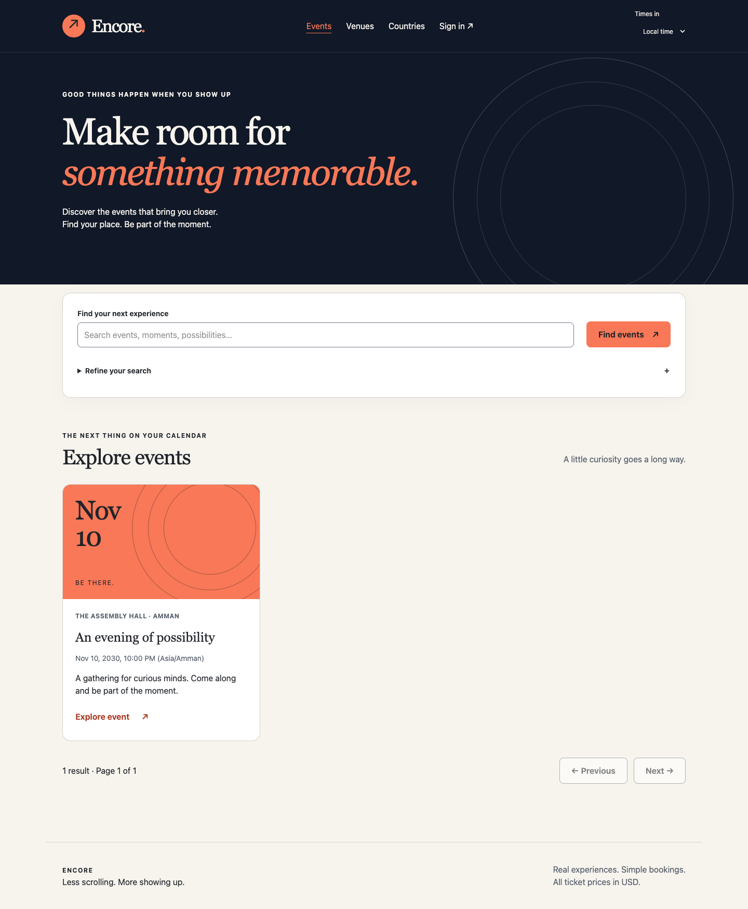

# Encore frontend

Responsive event discovery, booking, and administration built with React, strict
TypeScript, Vite, TanStack Query, React Router, Zustand, and Tailwind CSS.



*Screenshot uses mocked event fixtures; [mobile layout](artifacts/discovery-mobile.png).*

## Local development

Requirements: Node.js 22.12+, npm, and the running backend from the
[root setup guide](../README.md#run-locally).

```sh
cd EventTicketingFrontend
npm ci
cp .env.example .env.local
npm run dev
```

Open **http://localhost:5173/events**. Use localhost, rather than the loopback IP,
to match backend CORS. The public frontend setting is:

```dotenv
VITE_API_BASE_URL=https://localhost:7209
```

Trust the backend's local HTTPS certificate. The client does not proxy away CORS or
disable certificate verification. Vite environment variables are public build inputs;
never put credentials in them.

## Application flows

- Search/filter/paginate public events, countries, and venues.
- View event details, availability, and exact USD prices with a local/UTC display option.
- Register, sign in with opaque bearer tokens, refresh, view profile, and log out locally.
- Select tickets, review fresh inventory/prices, create a booking once, and recover
  uncertain outcomes through personal booking history.
- Partially/fully cancel owned tickets with explicit deadlines and historical totals.
- Admin country management, venue creation/deletion, event/category workspaces,
  protected booking history, and organizer/admin account creation.

Venue editing and a complete owned-event dashboard still need to consume the backend's
new capacity/organizerId/mine contract. See the [frontend handoff](../docs/FRONTEND_HANDOFF.md).
No payment, refund, QR, assigned-seat, or temporary-hold interface is implemented.

## Architecture

Feature-owned API decoders and queries separate server data from UI composition.
TanStack Query owns resources; URL parameters own shareable filters; forms stay local.
The session vault holds credentials in memory only. Reloading ends the local session.
Private caches are removed on account replacement/logout.

Money uses lossless JSON parsing, validated decimal strings, and bigint cents;
category writes serialize exact JSON numbers. Backend checks remain authoritative
for prices, inventory, dates, and permissions.

See [ARCHITECTURE.md](ARCHITECTURE.md), [API_CONTRACT.md](API_CONTRACT.md), and
[DESIGN_SYSTEM.md](DESIGN_SYSTEM.md) for implementation conventions.

## Checks

```sh
npm run check
npm run format:check
npm run test:e2e
```

The recorded results include 35 unit/integration tests and 15 mocked Chrome journeys.
The browser suite uses an isolated production preview on port 4173; it does not
create real bookings. See [VERIFICATION.md](VERIFICATION.md) for the precise coverage
and separate live read-only smoke result.

Chrome is the default browser channel. To use Playwright Chromium instead:

```sh
npx playwright install chromium
PLAYWRIGHT_CHANNEL=chromium npm run test:e2e
```

## Deployment configuration

Set an HTTPS VITE_API_BASE_URL at build time and configure the exact frontend origin
in backend CORS. The static host must return index.html for client routes without
rewriting API paths to the SPA. No deployed URL is claimed by this repository.
