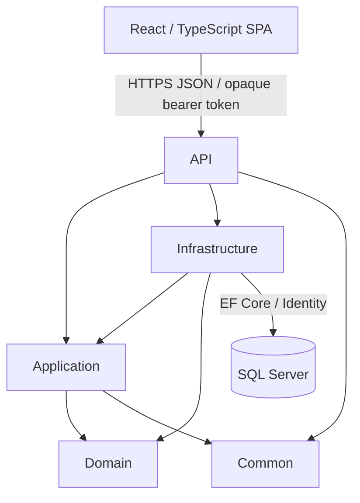

# Architecture

Encore consists of an ASP.NET Core API, a SQL Server persistence layer, and a separate
React/TypeScript SPA. Business decisions live behind service contracts; controllers
translate requests and Results into HTTP responses.

## Project dependencies

| Project | Responsibility |
| --- | --- |
| EventTicketingApi | Controllers, Identity route composition, middleware, CORS, HTTP current-user adapter, and DI |
| EventTicketingApi.Application | Service contracts, request/response DTOs, validation, serialization, and AutoMapper profiles |
| EventTicketingApi.Domain | Plain entities, booking states, and peak simultaneous event-capacity calculation |
| EventTicketingApi.Infrastructure | Concrete services, EF mappings/migrations, Identity users, logging, and database transactions |
| EventTicketingApi.Common | Framework-independent Result/error types and shared constants |
| EventTicketingApi.IntegrationTests | xUnit tests using real HTTP, Identity tokens, and isolated SQL Server databases |

Domain and Common have no project references. Infrastructure implements Application
contracts. Services access the scoped AppDbContext directly; there is no generic
repository, CQRS bus, or MediatR dependency.

## Request flow

1. Authentication middleware validates the caller; controller attributes restrict roles.
2. The controller passes a DTO/cancellation token to its Application service contract.
3. Infrastructure validates use-case input, checks ownership, and coordinates persistence.
4. Results represent expected validation/missing/conflict/forbidden outcomes; controllers
   translate them into ProblemDetails/status codes. Unexpected exceptions reach the
   global exception handler, which logs the exception and returns a generic response.
5. Read DTOs are projected or mapped without exposing tracked EF entities.

## Identity and ownership

Identity uses its built-in opaque bearer access/refresh tokens, not custom JWT issuance.
Public registration always assigns User. Admin-only account creation can assign Admin
or EventOrganizer. ICurrentUser exposes the signed-in ID/roles without coupling service
contracts to HttpContext. Its HTTP implementation lives in API.

Event stores OrganizerId as a string; Infrastructure maps its Identity foreign key.
EventAccess checks Admin or the owning EventOrganizer for management operations.
Bookings belong to the authenticated CustomerId. Personal booking reads/cancellation
remain owner-only; separate authorized event history is read-only for managers.

## Inventory and transactions

Booking creation locks the event, validates categories, conditionally increments
BookedQuantity, and saves the booking/items in one transaction. Availability reads
are advisory. Category capacity and booked-count constraints provide an additional
persistence boundary; booked quantities cannot become negative or exceed capacity.

Partial cancellation uses cumulative per-item targets. Inside a transaction, the
service locks the event and owned booking, releases only the newly cancelled quantity,
and saves item counts/status. A retry cannot release the same inventory twice.
Historical quantities, prices, and category names are retained.

Category allocations stay within event capacity. Category writes and event updates
also enforce booking-history restrictions. SQL Server-specific locking and constraints
are verified against SQL Server, rather than inferred from an in-memory provider.

## Venue scheduling

EventCapacitySchedule calculates peak simultaneous event allocation using start/end
changes, with intervals [start, end). VenueCapacityValidator loads relevant periods;
event create/update and venue-capacity edits hold venue update locks through commit.
Moves lock both venues in ID order before the event. Existing booking/category writes
then use event/category locks. This protocol coordinates multiple API instances.

The rule limits simultaneous allocations, not the sum of every event on a venue's
calendar. There is no cross-row declarative database constraint for the schedule;
all application schedule writers must follow the shared transaction protocol.

## Time and money

Event storage uses UTC-convention DateTime. Event write converters accept ISO timestamps
or calendar-only dates; date-only end days are inclusive and converted to the following
midnight. Internally the end instant is exclusive. SQL reads can omit the UTC suffix;
clients normalize those documented event strings as UTC. Booking timestamps are
DateTimeOffset, and TimeProvider makes cutoff tests deterministic.

USD unit-price snapshots use decimal(18,2); booking totals use decimal(20,2). The API
serializes numeric JSON values. Encore's client preserves monetary tokens at the JSON
boundary and uses decimal strings/bigint cents rather than binary floating-point arithmetic.

## Frontend boundary

The SPA has feature-owned API modules/runtime decoders, TanStack Query resource caches,
React Router navigation, local form state, and a memory-only credential vault. Private
queries are scoped to session generation. CORS permits explicit origins; /api/auth/me
provides profile/roles because the access token is opaque.

The backend now exposes venue capacity, event organizerId, and /api/events/mine.
The pending frontend integration is specified in [FRONTEND_HANDOFF.md](FRONTEND_HANDOFF.md).
See the [frontend architecture](../EventTicketingFrontend/ARCHITECTURE.md) for client boundaries.

## Verification and remaining scope

The latest backend suite contains 48 passing tests. It checks authorization, contract
mapping, inventory/schedule races, rollback, cancellation deadlines, and response privacy.
Each integration test owns a uniquely named local database and removes it afterward.

Payments, issued/QR tickets, assigned seats, expiring holds, create-request idempotency,
and deployment automation are separate roadmap items. They are not implied by the
current booking-confirmation state.
